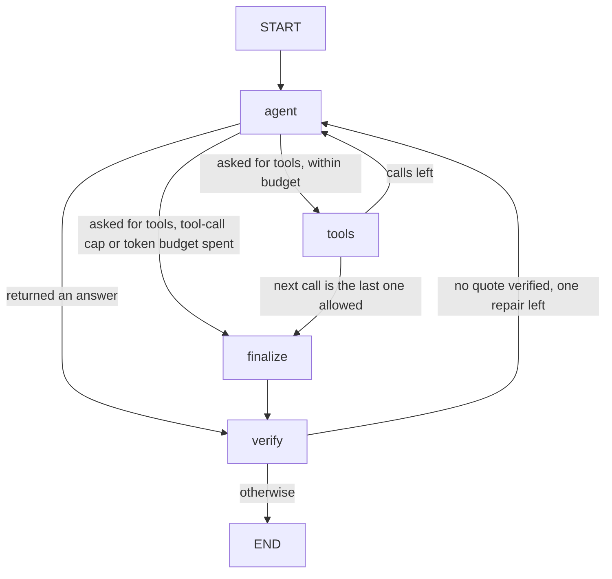

# PLAN_AGENT.md — an agent mode alongside the pipeline

Status: proposal, nothing built. Written 2026-11-21 after reading the engine, the eval harness, the CLI and the current LangGraph docs.

## 1. The short version

Add a second way to answer a question. Today code picks the excerpts and the model answers once. In agent mode the model gets three read-only tools (search, read a chunk, list filings), calls them in a loop until it decides it has enough, then returns the same answer JSON as today. That JSON goes through the **same** quote verifier, so the trust rule does not move: no verified quote, no answer.

Everything after the answer row (presentation, memo, claim check, grading) is untouched, because the row has the same shape.

**Framework: LangGraph 1.2.24, using only its graph runtime, with the model called through the Anthropic SDK this project already uses.** Reasons and the alternatives are in section 2.

What this is, said plainly for an interview: *a ReAct-style tool loop expressed as a small state machine, with a deterministic verifier as the last node and hard budgets enforced by the graph's routing, measured against a non-agentic baseline on the same answer key.*

## 2. Framework choice

### What I checked (docs and package index, 2026-11-21)

| | LangGraph | Pydantic AI | Anthropic SDK tool loop | Claude Agent SDK |
|---|---|---|---|---|
| Current version | 1.2.24 (released 2026-11-20) | 2.71.0 | already installed (1.8.0) | 0.2.187 |
| New packages installed | about 25 (20 today, 45 after) | about 4 | 0 | not resolved |
| Who writes the loop | you, as nodes and edges | built in | you (about 60 lines) or the SDK's beta tool runner | built in |
| Step and token limits | you route on counters in state; `recursion_limit` is a backstop | built-in `UsageLimits` | you write them | not checked |
| Explicit graph you can draw and explain | yes | no (internal) | no | no |
| Multi-agent later | subgraphs, `Send`, `Command` | agents calling agents | hand-written | subagents |

### Recommendation: stay with LangGraph

- **It fits the stated goal.** You want a framework implementation you can talk about, and LangGraph's own docs define the workflow-versus-agent distinction this project now straddles. The graph is explicit, so the design in section 3 is the thing you draw on a whiteboard.
- **It does not force LangChain on the engine.** The docs say LangGraph does not require LangChain and that nodes are plain functions. So the model node can call `filingroom/llm.py`, which keeps the cost meter, the spend caps and the refusal handling in one place.
- **Phase 2 has a natural home.** Planner, researcher and verifier become nodes or subgraphs of the same graph.

### Is another framework clearly better? No, but two honest caveats

- **Pydantic AI would be less code and far fewer packages.** Its built-in loop, `UsageLimits` and output validators map almost one-to-one onto "tool loop, budgets, verify the quotes". If the goal were only the smallest correct agent, I would pick it. It loses on your stated criterion (job-posting recognition) and on having a graph you define yourself. It would also need `anthropic>=1.15`, a bump from the locked 1.8.0.
- **No framework at all is the smallest change.** The Anthropic SDK can run this loop with zero new dependencies. That is the best fit for a three-dependency project, and worth saying in an interview: *the framework is here because I wanted to learn and show it, not because the problem needs it.* We use none of LangGraph's headline features (persistence, human-in-the-loop, streaming).
- **Claude Agent SDK is a poor fit.** It is the Claude Code harness as a library, built around file and shell tools. We want three narrow tools and tight control of every model call.

### What the dependency costs

- **About 25 new packages**, including `langchain-core`, `langsmith`, `pydantic` (already present), `requests`, and the older `httpx` alongside the `httpx2` the Anthropic SDK uses.
- **`langsmith` is a tracing client for a hosted service.** The docs say tracing is enabled by setting `LANGSMITH_TRACING=true` plus an API key; they do not state the default in so many words. Because this project is "local and private", increment 3 reads the installed source to confirm, sets `LANGSMITH_TRACING=false` explicitly in code, and adds a test that an agent run opens no connection other than to the Anthropic API.
- **Fast release cadence.** Four releases in nine days. Pin the exact version; keep every `langgraph` import in one file.
- **The Anthropic SDK must not move.** An unconstrained resolve picks `anthropic` 2.12.0. The lock stays at 1.8.0 so the pipeline's SDK is unchanged; I will check the `uv.lock` diff.

### One decision for you: `langchain-anthropic`

The LangGraph quickstart calls Claude through LangChain (`init_chat_model(...).bind_tools(...)`), which needs two more direct dependencies (`langchain`, `langchain-anthropic`). I recommend **not** adding them:

- The model call would bypass `llm.py`, so cost metering and the spend caps would need a second implementation.
- The project's structured-output and effort settings go through `output_config`, which I have verified on the Anthropic SDK but not on the LangChain wrapper.

The cost of my recommendation: the code looks less like the tutorials. The node functions are the same shape, though, and the quickstart also hand-writes its tool node.

## 3. Graph design

One graph run answers one question for one company. The checklist run stays what it is today: a thread pool calling "answer one question" 40 times.

### State

A `TypedDict` (the docs recommend it over Pydantic for speed). Fields that accumulate use a reducer, which is LangGraph's way of saying "append, don't overwrite".

| Field | Type | Purpose |
|---|---|---|
| `messages` | list, append reducer | The conversation in Anthropic's format, including tool calls and results. Assistant content is stored exactly as returned, because thinking blocks must be passed back unchanged. |
| `seen` | list of chunk ids, append-unique | Every chunk a tool has shown the model. Becomes the row's `retrieved`. |
| `model_calls`, `tool_calls` | int, add reducer | Step counters the router reads. |
| `tokens` | int, add reducer | Input plus output tokens so far, from each response's `usage`. |
| `draft` | dict or None | The model's answer JSON, before verification. |
| `repairs` | int | How many verify-then-retry rounds have run (0 or 1). |
| `stop` | str | Why the loop ended: `model_done`, `step_limit`, `token_limit`, `error`. |
| `row` | dict | The finished answer row. |

Things that are not data about the run (the ticker, the loaded `Index`, the `CostMeter`, the limits, the model-calling function) are passed as **runtime context** (`context_schema`), LangGraph's documented place for dependencies. That is also the seam for tests: a test passes a scripted fake in place of the model-calling function, the same pattern `present.py` already uses with `complete=`.

### Nodes

| Node | Kind | What it does |
|---|---|---|
| `agent` | model call | Sends system prompt, tools and messages. Either the model asks for tools, or it stops and its text is the answer JSON. |
| `tools` | plain code | Runs every requested tool, returns all results in one message, records `seen`. A bad argument comes back as an error result the model can read, not an exception. |
| `finalize` | model call | Used only when a budget ran out. Makes one call with tools switched off (`tool_choice: none`) so the model must answer from what it has seen or return `not_found`. Two entries: from `agent` when the turn's tool requests would pass the tool-call cap or the token budget is already spent (the requests get "limit reached" results); from `tools` after the last allowed tool round (the step limit), whose real results end with a note to answer now. *(Changed at checkpoint B: originally the step limit refused the second-to-last call's requests too, wasting that call.)* |
| `verify` | plain code | Runs the shared row builder: string-verifies each quote against the chunk it names, sets `unsupported` when none verify. No model involved. |

### Stop conditions, in the order they bite

1. **The model decides it is done.** It stops calling tools and returns the answer. This is the "genuinely agentic" part: nothing in code tells it how many searches to run.
2. **Step limit.** Default 6 model calls (the forced final answer included) and 8 tool calls per question. The tool-call cap is checked by the edge out of `agent`; the model-call limit by the edge out of `tools`, so the last tool round still runs and the final call answers from it.
3. **Token limit.** Default 30,000 tokens of exploration per question. The final answer call is always allowed, so the true ceiling is that plus one call; I will report the measured maximum. For scale, the pipeline uses about 10,100 input tokens per question today.
4. **Existing spend caps.** Every call goes through `llm.py`, so `CostMeter.limit` and `FILINGROOM_MAX_USD` still stop the whole command.
5. **`recursion_limit` backstop.** Set to a little over twice the model-call limit. If a routing bug ever loops, LangGraph raises `GraphRecursionError`; it is caught and the row becomes `status: error`.
6. **Request timeout** on the SDK client. LangGraph's own node timeouts apply only to async nodes, and this code is sync.

Why counters in state and not just `recursion_limit`: the docs do not say what happens to state when `GraphRecursionError` is raised. I want a limit to produce a normal, verified row, so the graph routes to `finalize` itself and the framework limit is only a safety net.

### How the final answer is produced

Each model call sends both `tools` and `output_config.format` set to the existing `ANSWER_SCHEMA`. The Anthropic docs show the two used together. When the model stops calling tools, its text is schema-valid JSON, exactly like the pipeline's.

To confirm in the first paid spike (about one cent): how the format constraint behaves on turns where the model calls a tool. Fallback if it misbehaves: a fourth tool, `submit_answer`, with `strict: true` and the same schema.

### The repair edge

If `verify` finds an answered draft with zero verified quotes, the model gets one message naming the quotes that failed and the chunks they were claimed from, and one more turn inside the same budgets. The row is still built by the same verifier afterwards, so this can only turn `unsupported` into `answered` by producing a quote that really is in the filing.

It is its own increment behind a switch, off at first, so its effect is measured, not assumed.

## 4. Tools

All three are read-only and bound in code to the one company being screened. The ticker is not a parameter, so the model cannot wander into another company's filings. Each is a plain function in `filingroom/agent/tools.py` with no framework import, which is what makes them testable with the stdlib.

### `search_filings`

| | |
|---|---|
| Wraps | `Index.search` in [index.py](filingroom/index.py) (BM25, forms as a hard filter, topics and periods as boosts) |
| Inputs | `query` (string, required); `forms` (subset of `10-K`, `10-Q`, `8-K`, `DEF 14A`); `topics` (subset of the index's topic tags, such as `financials`, `mdna`, `risk_factors`, `proxy`); `periods` (labels such as `FY2026`, `Q3 FY2026`); `k` (1 to 8, default 5) |
| Output | Ranked hits: `chunk_id`, form, period, filing date, section heading, subheading, score, and the full chunk text |
| Notes | A chunk already shown in this question comes back as its id marked "already shown", not the text again. Unknown form or topic returns an error listing the valid values. |

Full text and not snippets, because the model must copy quotes verbatim and a snippet would force a second call for every hit. The price is tokens, which the small `k` and the already-shown rule keep down.

### `get_chunk`

| | |
|---|---|
| Wraps | `Index.by_id` and `Index.neighbors` |
| Inputs | `chunk_id` (required); `neighbors` (0 or 1, default 1) |
| Output | The chunk, and with `neighbors: 1` the chunks immediately before and after it in the same section, in reading order |
| Notes | Unknown id returns an error result. |

This is the pipeline's `expand` step turned into a choice: the pipeline always adds neighbours of the top two hits; the agent asks for them when an answer seems to run across a boundary.

### `list_filings`

| | |
|---|---|
| Wraps | `edgar.manifest` and `checklist.periods` |
| Inputs | none |
| Output | One line per filing in the current set (doc id, form, period, period end, filing date, sections with chunk counts), plus the resolved labels: latest fiscal year, prior fiscal year, latest quarter release, latest proxy |

### What the agent is and is not told

- **Told:** the same question text, answer type and "Target period" line the pipeline sends, and the same answering rules (use only the filings, quote verbatim, scale notes, `not_found` when absent). These go in a new `prompts/agent.md`; `prompts/answer.md` is not edited.
- **Not told:** the checklist's hand-tuned `where` and `search` hints. Those are the pipeline's retrieval knowledge. Withholding them is the experiment: can the model find the passage without them? It also matches the app's free-text questions, which have no hints at all and are where I expect agent mode to help most.

## 5. Where it plugs in

The seam is one function. Today everything calls `answer.answer_question(ticker, q, ix, meter, ...)` and gets a row. Agent mode adds `agent.answer_question` with the same signature and the same return shape, and a tiny chooser picks between them.

| File | Change |
|---|---|
| `filingroom/agent/tools.py` (new) | The three tools as pure functions. |
| `filingroom/agent/graph.py` (new) | State, nodes, edges. The only file that imports `langgraph`, and it is imported lazily so pipeline mode never loads it. |
| `filingroom/agent/__init__.py` (new) | `answer_question(...)`: builds the first message, invokes the graph, returns the row. |
| `prompts/agent.md` (new) | System prompt for agent mode. |
| [llm.py](filingroom/llm.py) | New function `complete_tools(...)` beside `complete_json`, sharing the meter, caps and refusal handling. `complete_json` is not edited. |
| [answer.py](filingroom/answer.py) | Lines 130 to 149 (verify quotes, set status, build the row) move into a function `build_row(...)` that both modes call. Behaviour-preserving; guarded by a test written first. |
| [pipeline.py](filingroom/pipeline.py) | `run_checklist` gains `mode="pipeline"`; records it in the run file's `meta`. |
| [evaluate.py](filingroom/evaluate.py) | `run` gains `mode="pipeline"`; a new free `compare` function. |
| [cli.py](filingroom/cli.py) | `--mode pipeline\|agent` on `ask`, `run`, `eval`; new `compare` command; `--max-steps`, `--max-tokens-per-question`. |
| `pyproject.toml`, `uv.lock` | `langgraph==1.2.24`. |

### The answer row

Agent rows carry every key a pipeline row has, with the same types, so [present.py](filingroom/present.py), [memo.py](filingroom/memo.py), [findings.py](filingroom/findings.py) and the judge read them unchanged. Mapping of the keys that need a decision:

- `retrieved`: every chunk id a tool showed the model. This keeps the "was the number in what the model saw" check meaningful.
- `k`, `expand`: `None` in agent mode.
- `seconds`: wall time for the whole loop.
- Two additive keys, on agent rows only: `mode: "agent"` and `agent: {model_calls, tool_calls, tokens, usd, stop, repairs, trace}`. `trace` is the ordered list of tool calls with their arguments and returned chunk ids, so any answer can be replayed by eye.

Pipeline rows get no new keys, so their output is identical to today's.

### Not in the first phase: the app

`server.py` keeps calling the pipeline. Putting agent mode in the app means a cost estimate shown before the run, resume rules for half-finished runs in a different mode, and UI copy, all of which CLAUDE.md asks to be designed. It is listed as a later increment.

## 6. Keeping the trust guarantees

- **Same verifier, literally.** Both modes call `answer.build_row`, which calls the existing `verify_quote`. There is one implementation of "does this quote appear in the chunk it names".
- **Same rule.** Answered with zero verified quotes becomes `unsupported`.
- **One extra diagnostic.** For each citation, record whether the cited chunk was ever shown to the model in this run. A verified quote from a never-shown chunk would mean the model answered from memory and got lucky; it should never happen, and the comparison reports the count.
- **Filing text is data.** Tool results are excerpts from SEC filings. The tools cannot write, fetch or act, and are scoped to one company, so text in a filing has nothing to hijack.

## 7. Evaluation: both modes, one answer key

### Running

- `./fr eval --mode agent --label <name>` answers the same golden items through the agent and grades them with the same grader and judge.
- Agent results are written to `results/agent/`, with their own changelog file. The existing Evaluation area and `latest_result` read only `results/*.json`, so the pipeline's history, trend and changelog stay clean.

### Comparing

`./fr compare <pipeline result> <agent result>` is free (no API calls) and prints:

| Metric | Source |
|---|---|
| Accuracy, overall and by grade type, with 95% Wilson intervals | `correct` on each row; `evalstats.py` |
| Items that flipped each way, with an exact sign test | paired by golden id; `evalstats.py` |
| Unsupported rate | existing `unsupported_claim_rate` |
| False "not found" and abstention precision | existing metrics |
| Verified-but-wrong (the app's trust metric) | `findings.derive_status`, as the Evaluation area does |
| Cost, total and per question | each run's meter |
| Latency: mean, median, 90th percentile | `seconds` on each row |
| Model calls and tool calls per question; share of questions that hit a limit | `agent` block (pipeline is 1 and 0 by definition) |

The pipeline side can be the recorded run `results/2026-09-27_1616_recency.json` (93.6% on 80 items, $1.91 answering, 4.5 s mean per question), which costs nothing. Its latency was measured on a different day, so the final comparison should run both modes in one session.

### Two things to say out loud about the comparison

- **80 paired items cannot detect a small accuracy difference.** If agent mode lands within a few points, the honest finding is "no detectable difference in accuracy; here is what it cost". Cost, latency and tool calls will be unambiguous.
- **An agent run is one sample.** The model's path varies between runs. The intervals are there for that reason.

BOX stays untouched during development. It was the pipeline's held-out company and is still unseen by agent mode, so one `--final` agent run at the very end would be a real held-out number.

## 8. Tests

Stdlib `unittest`, like the existing suite; no pytest. The graph is tested with a scripted fake model, so every test is free and deterministic.

- **Pipeline unchanged.** Written before the refactor: with a stubbed model reply, `answer.answer_question` returns exactly the same row before and after `build_row` is extracted. Importing the CLI and running a pipeline answer does not load `langgraph`.
- **Tools.** Forms filter excludes other forms; topic and period boosts reorder; `k` is clamped; unknown form, topic or chunk id returns an error result; neighbours come back in reading order; an already-shown chunk is returned by id only; `list_filings` matches the manifest.
- **Loop and limits.** A fake model that always asks for tools is stopped at the step limit, `finalize` is called once with tools off, and a row comes out with `stop: step_limit`. Same for the token limit. The `recursion_limit` backstop yields an `error` row.
- **Verification.** A fabricated quote gives `unsupported`; a real quote gives `answered`; `not_found` passes through; with repair on, exactly one extra round runs.
- **Row shape.** An agent row has every key of a pipeline row with matching types, and passes through `present.eligible`, `memo.usable` and `findings.derive_status`.
- **Compare.** Fixed synthetic results in, expected table out.

## 9. Main risks

| Risk | Why it is real here | Handling |
|---|---|---|
| Cost grows with every step | Each loop turn resends the transcript so far. | Small `k`, already-shown rule, per-question token budget, prompt caching on the stable prefix, spot checks before any full run. Estimates in section 11. |
| Agent mode is less accurate than the tuned pipeline | The pipeline's retrieval was tuned and measured (100% retrieval recall on numeric items). The agent starts without those hints. | That is a result, not a failure. Report it. A "with hints" variant is a cheap follow-up experiment. |
| More false answers on "should be not found" items | An agent that keeps searching may find something loosely related and answer. Abstention precision is already the pipeline's weakest number (61.5%). | Same abstention wording in the prompt; watch the 8 abstain items in the first spot check. |
| The format-plus-tools behaviour differs from what I expect | Verified in docs as supported together, not yet exercised on this model. | One-cent spike in increment 4; `submit_answer` strict tool as fallback. |
| Framework surprises | Step counting per "super-step", thread safety of one compiled graph across six worker threads, and state on recursion error are not spelled out in the docs I read. | Increment 3 is a free spike with a fake model that pins each of these down with a test. Fallback for thread safety: compile one graph per worker. |
| Tracing leaves the machine | `langsmith` arrives as a transitive dependency. | Confirm default in source, force it off, test for it. |
| Eval history gets muddied | Agent results mixed into `results/` would bend the trend chart and "previous run" comparisons. | Separate folder and changelog. |
| Spend-cap accounting | `_command_spend` in `llm.py` counts only uncached input tokens. Harmless today because the pipeline never caches; wrong once agent mode caches. | `complete_tools` counts cached tokens at their real rates. Pipeline accounting is unaffected. |

## 10. Increments

Each ends with the full test suite passing and is small enough to review in one sitting. Paid steps are marked and each needs your go-ahead.

1. **Guard the pipeline.** Characterisation test for `answer_question`, then extract `build_row`. No behaviour change. Free.
2. **Tools.** `agent/tools.py` and its tests. No framework yet. Free.
3. **Add LangGraph; graph skeleton with a fake model.** State, four nodes, edges, limits, backstop. Tests for limits and verification. Confirms step counting, thread safety and tracing-off. Free.
4. **Real model.** `llm.complete_tools`, `prompts/agent.md`, `./fr ask --mode agent`. Try three questions (a number, a list, one that should be not found). **Paid, about $0.20.**
5. **Whole checklist and spot checks.** `--mode` on `run` and `eval --only`; trace in the row. Spot-check five golden items. **Paid, about $0.40.**
6. **Comparison tooling.** `eval --mode agent` to `results/agent/`, `./fr compare`, tests. Free (compare runs against recorded files).
7. **Measure.** A 20-item stratified subset first. **Paid, about $1.50.** Then decide together whether a full 80-item run is worth it (**estimated $4 to $6**, above the $3 per-command cap, so it needs an explicit raise).
8. **Repair edge.** Turn it on, rerun the subset, keep or drop on the numbers. **Paid, about $1.50.**
9. **Write it up.** README section with the comparison table; update CLAUDE.md (architecture, the dependency line, the eval notes) and the `pyproject.toml` description.

Later, each its own plan: agent mode in the app; the held-out BOX run; phase 2.

## 11. Cost estimate (to be replaced by measurements)

- **Pipeline today:** $0.024 and about 10,100 input tokens per question (from the recorded 80-item run).
- **Agent, typical guess:** two searches and one chunk read, four model calls, roughly $0.04 to $0.07 per question, so 1.5 to 3 times the pipeline. Prompt caching should pull this toward the low end; whether the prefix is long enough to cache on this model is checked in increment 4.
- **Agent, ceiling:** bounded by the per-question token budget at roughly $0.10.
- **Total to reach a first comparison (increments 4 to 7, subset only):** about $2.10.

## 12. Phase 2: multiple agents (noted, not built)

The single loop splits along lines the graph already has:

- **Planner** sits between `START` and `agent`. It reads the question and `list_filings` and writes a short plan into state: which filings, which sub-questions (for example "revenue this year" and "revenue last year" for a growth rate).
- **Researcher** is today's `agent` plus `tools` loop, wrapped as a subgraph. With a planner, one researcher can run per sub-question in parallel using LangGraph's `Send`.
- **Verifier** is today's `verify` node, extended. The string check stays deterministic and stays the gate. A model-based verifier could be added beside it to judge whether the quotes actually support the answer, which today only the eval judge and the memo claim check do.

Hand-off is through state: plan in, evidence out, verdict out. A further step is one orchestrator across the whole checklist, so a passage found for one question is available to the next; today the 40 questions are independent.

## 13. Decisions I need from you

1. **Framework:** LangGraph 1.2.24, pinned, with about 25 transitive packages. Approve, or prefer Pydantic AI or no framework?
2. **Model access:** call Claude through the existing `llm.py` (my recommendation), or add `langchain` and `langchain-anthropic` to match the tutorials?
3. **Model:** keep `claude-sonnet-5` at medium effort, the same as the pipeline, so the comparison isolates "who chooses the excerpts". A newer model would be a separate experiment.
4. **Hints:** withhold the checklist's `where` and `search` hints from the agent (my recommendation), or give them?
5. **Spend:** about $2.10 across increments 4 to 7 for a first comparison, each step confirmed before it runs.

## 14. What is verified and what is not

**Read in current docs or package metadata:** LangGraph version and dependencies; `StateGraph`, `TypedDict` state with reducers, `add_node`, `add_conditional_edges`, `START`/`END`; `recursion_limit` in the invoke config and `GraphRecursionError` from `langgraph.errors`; runtime context via `context_schema`; node timeouts are async-only; LangGraph does not require LangChain; the quickstart's hand-written tool node; Pydantic AI's built-in loop and `UsageLimits`; Anthropic tool use together with `output_config.format`, `strict` tools, and `tool_choice: none`.

**Not yet verified, each assigned to an increment:** format-constraint behaviour on tool-calling turns for `claude-sonnet-5` (4); whether prompt caching engages at this prefix length (4); that `anthropic` 1.8.0 accepts every parameter used (4).

### Found in increment 3 (2026-11-21, langgraph 1.2.24, langsmith 0.16.0, langchain-core 1.8.4)

Each finding is pinned by a test in `tests/test_agent_graph.py` (class `SpikeTest` unless noted).

- **Dependency.** `uv add langgraph==1.2.24` added 26 packages and changed none: the `uv.lock` diff is additions only, and `anthropic` stays 1.8.0, `pydantic` 2.13.5. `httpx` 0.28.1 now sits beside the SDK's `httpx2`.
- **LangSmith tracing default: off, but easy to turn on by accident.** From the installed source: `langsmith.utils.tracing_is_enabled()` checks, in order, a context variable, an active run tree, a process-wide switch set by `langsmith.configure(enabled=...)`, and only then the environment. In the environment it reads `LANGSMITH_TRACING_V2`, then `LANGCHAIN_TRACING_V2`, then falls back to `LANGSMITH_TRACING` and `LANGCHAIN_TRACING`; the value must be exactly `"true"`. With none set, it is off. Two traps: (1) `LANGSMITH_TRACING=false` alone does **not** switch off a `LANGCHAIN_TRACING_V2=true` (the `_V2` names are checked first); (2) the environment lookup is cached (`functools.lru_cache`), so changing a variable after langsmith has read it does nothing. `langchain-core` adds tracers only when that same function says yes. **What the code does:** `graph.py`, before importing langgraph, sets all four variables to `false`, clears the cache, and calls `langsmith.configure(enabled=False)`, which takes precedence over the environment. **Tests:** with every tracing variable set to `true` and a LangSmith API key present, an agent run (fake model) makes zero socket connections and zero DNS lookups, builds no `langsmith.Client`, and `tracing_is_enabled()` is `False`. A control test shows the same environment does turn tracing on without the switch, and that `LANGSMITH_TRACING=false` alone does not.
- **How super-steps count against `recursion_limit`.** Each node run is one super-step (our nodes never run in parallel). Writing the input also counts as one, and the limit is checked *before* the "nothing left to run" check, so a path of n node steps needs `recursion_limit >= n + 1`: at exactly n, every node, `verify` included, has run and LangGraph still raises `GraphRecursionError`. Measured: the 12-step step-limit path (agent and tools five times each, finalize, verify) completes at 13 and raises at 12 after all 12 nodes ran. `graph.run` handles that edge (if `verify` had finished, its row is returned). The backstop is `2 * max_model_calls + 3`: at most M model calls run and every other step directly follows one, so a legal run is at most 2M steps. An exhaustive test over all 162 scripts at M = 4 (tool turns, fabricated answers, good answers; repair on and off) finds the longest legal path is exactly 2M (tool rounds all the way, then finalize and verify) and none reaches the backstop. Default `recursion_limit` is 10,007 (`LANGGRAPH_DEFAULT_RECURSION_LIMIT`).
- **Concurrent `invoke` from several threads: safe for this graph.** One compiled graph, six worker threads, twelve questions, a barrier so all six runs are inside the graph at the same time, and a fake model that asserts it sees only its own question and echoes the question id into its search queries and answer. Every row's `qid`, answer text, trace queries and counters match its own question (`GraphTest.test_one_compiled_graph_six_threads_no_state_crosses`). This fits how it is built (no checkpointer, so each call starts from fresh channels; the runtime context is passed per call), though I did not audit the scheduler's internals. So `compiled()` caches one graph per process; the fallback (one graph per worker) is not needed.
- **State after `GraphRecursionError`.** `invoke` raises and returns nothing; without a checkpointer the run's state is gone (the docs are silent, and there is nothing to read back). `graph.run` therefore uses `stream(stream_mode="values")`, which yields the full state after every super-step, and keeps the last one. On the error it builds an `error` row that still reports the model calls, tool calls, tokens, spend, trace and seen chunks up to the last completed step (`GraphTest.test_recursion_backstop_gives_an_error_row_with_partial_counts`).
- **Pipeline mode never loads the framework.** Importing `filingroom.cli`, `answer`, `pipeline`, `evaluate`, `filingroom.agent` and `filingroom.agent.tools`, then answering a question in pipeline mode, leaves `langgraph`, `langsmith` and `langchain_core` out of `sys.modules` (subprocess test).
- **A bug the tests caught in my own routing, not in the framework.** With the repair edge on, a repair round that started with one model call left could ask for tools and then `finalize` would make call M + 1. A repair now needs two calls of budget left. Repair stays off by default.
